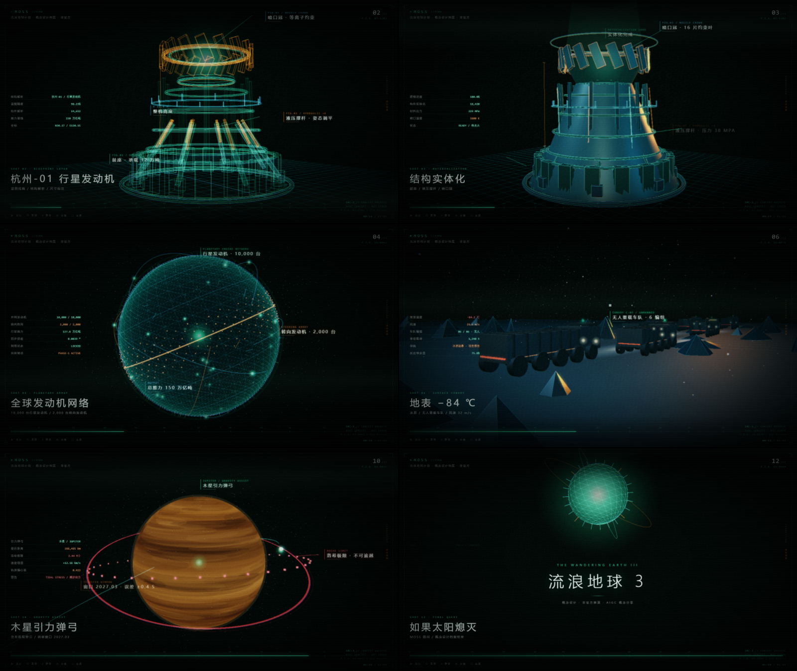

<div align="center">

# MOSS // 流浪地球 3 概念设计解说

**120 秒 · 12 段分镜 · MOSS 第一视角 · 纯代码生成的实时 WebGL 概念预告**

[](LICENSE)
[](https://threejs.org)
[](#技术实现)
[](#性能与兼容性)
[](#免责声明)

[在线观看](https://michuan.github.io/moss-wandering-earth-3-concept/) ·
[分镜表](#分镜表) ·
[技术实现](#技术实现) ·
[部署](#部署) ·
[自定义](#自定义)



</div>

---

## 免责声明

> 本项目是**粉丝自发的 AIGC 概念设计练习**，与《流浪地球》系列出品方、版权方**没有任何关联**，不是官方物料，不代表官方设定，也不含任何未公布剧情。
>
> 片中所有结构、数据、台词均为**基于已公开的世界观做的推演与想象**（例如发动机结构、缆绳参数、外骨骼测试数值），不构成剧透。
>
> 未使用任何真实演员肖像、官方剧照、官方模型或官方音频。所有画面都是浏览器里的实时几何体，所有声音都是 `OscillatorNode` 现场合成。
>
> 若版权方认为内容不妥，请通过 Issue 联系，我会立即下架。

---

## 这是什么

一个**跑在浏览器里的 120 秒概念预告片**。没有视频文件、没有一帧图片、没有一个 3D 模型文件——你看到的行星发动机、冰原车队、天梯缆绳、木星条纹、太阳日面，全部是运行时用 `BoxGeometry`、`CylinderGeometry`、`CanvasTexture` 和着色器一行行堆出来的。

叙事视角是 MOSS：从「文明延续概率加载」开始，到「如果太阳熄灭，你会带着地球走吗？」结束。12 段分镜，每段 9–11 秒，覆盖行星发动机、全球网络、目的地、地表作业、地下城、轨道设施、装备测试、引力弹弓、太阳异常九个设定切片。

```
蓝图线稿  ──▶  实体建模  ──▶  数据标注  ──▶  下一镜头
   ↑              ↑              ↑
 边缘线框      裁剪面推进      3D 锚点投影
```

## 亮点

- **零外部资源**：无 CDN、无模型文件、无贴图、无音频文件。断网、`file://` 双击打开也能完整播放。
- **逐帧建模动画**：杭州-01 发动机从 18,420 个构件的蓝图线稿开始，用一个移动的裁剪面把实体从下往上「打印」出来，线稿同步退为高光。
- **真 HUD**：F.I.G. 编号、SRC 系列水印、测距线、引线标注、遥测表都在跟随镜头投射，不是贴上去的图。
- **程序化音频**：低频脉冲 + 金属 FM 撞击 + 噪声 riser 全部由 Web Audio 合成；MOSS 旁白走 `SpeechSynthesis`，系统没有中文语音时自动降级为「通讯脉冲」。
- **可交互**：12 段任选跳转、进度条拖拽、全屏、静音、分镜表（`B`），支持深链参数做免 UI 录制。
- **自适应画质**：连续掉帧自动下调渲染分辨率，回到 60fps 再升回去。

## 快速开始

不需要 Node、不需要构建、不需要联网。

```bash
git clone https://github.com/MiChuan/moss-wandering-earth-3-concept.git
cd moss-wandering-earth-3-concept
```

然后任选一种：

| 方式 | 命令 |
| --- | --- |
| 直接打开 | 双击 `index.html` |
| 本地服务器（推荐，语音/音频策略更友好） | `python -m http.server 8000` → `http://localhost:8000` |
| Node | `npx serve .` |

点「唤醒 MOSS」进入，建议全屏 + 耳机。

## 操作

| 按键 | 功能 |
| --- | --- |
| `Space` | 播放 / 暂停 |
| `←` `→` | 后退 / 前进 5 秒 |
| `M` | 静音切换 |
| `B` | 打开 / 关闭分镜表 |
| `F` | 全屏 |

点击进度条可任意跳转，分镜表里点任意一格直达该段。

### 深链参数

适合嵌入 iframe、OBS 录制、或生成封面截图：

| 参数 | 说明 | 示例 |
| --- | --- | --- |
| `autoplay=1` | 跳过唤醒门直接播放 | `?autoplay=1` |
| `shot=7` | 从第 7 段开始（1–12） | `?autoplay=1&shot=7` |
| `t=4` | 该段内第 4 秒 | `?autoplay=1&shot=7&t=4` |
| `paused=1` | 定格在指定帧 | `?autoplay=1&shot=3&t=6&paused=1` |
| `mute=1` | 静音启动 | `?autoplay=1&mute=1` |
| `hud=0` | 隐藏全部 HUD，只留画面 | `?autoplay=1&hud=0` |

> 例：`index.html?autoplay=1&hud=0&mute=1` 就是一条干净的画面流，可以直接叠进剪辑软件。

## 分镜表

| # | 时间码 | 时长 | 分镜 | 画面要点 | MOSS 旁白 |
| :-: | --- | :-: | --- | --- | --- |
| 01 | 00:00–00:09 | 9s | MOSS 已唤醒 | 黑屏扫描线、环形加载、概率计数 0→99.97% | MOSS，已唤醒。 |
| 02 | 00:09–00:20 | 11s | 杭州-01 行星发动机 · 蓝图 | 边缘线框生成，鼓座 / 液压撑杆 / 喷口冠逐条引线 | 杭州一号，行星发动机。 |
| 03 | 00:20–00:30 | 10s | 结构实体化 | 裁剪面自下而上推进，线稿退为高光，等离子引燃 | 鼓座。液压撑杆。喷口冠。 |
| 04 | 00:30–00:40 | 10s | 全球发动机网络 | 球壳 10,000 点 + 赤道 2,000 台转向机 + 同步弧 | 一万台行星发动机，两千台转向机。 |
| 05 | 00:40–00:49 | 9s | 目的地 半人马座 α | 三合星、4.2 光年标尺、航迹解算 | 四点二光年。 |
| 06 | 00:49–01:00 | 11s | 地表 −84 ℃ | 冰原低照度、六编组无人车队、风场雪粒 | 车队无人。人类，在地下。 |
| 07 | 01:00–01:10 | 10s | 地下城通风塔 | 剖切壳体、热/冷双粒子柱、地下城光点 | 冷热交换，效率百分之九十二。 |
| 08 | 01:10–01:20 | 10s | 利伯维尔赤道锚点 | 缆绳爬升、同步轨道站、硬对接倒计时 | 同步轨道，对接。 |
| 09 | 01:20–01:29 | 9s | 外骨骼无人对抗 | 冲拳、冲击环、载荷曲线峰值 18.6 kN | 冲击载荷，峰值超限。 |
| 10 | 01:29–01:40 | 11s | 木星引力弹弓 | 弹弓轨迹、洛希极限红色警戒环、窗口误差 | 洛希极限。不可逾越。 |
| 11 | 01:40–01:50 | 10s | 太阳核心异常 | 日面颗粒、剖面盘、中微子通量告警 | 中微子通量，下降百分之三十八点四。 |
| 12 | 01:50–02:00 | 10s | 如果太阳熄灭 | 单眼收束、标题、提问、免责声明 | 你会带着地球走吗？ |

节拍不是均分的：`DURS = [9,11,10,10,9,11,10,10,9,11,10,10]`，重拍留白比十二等分更有呼吸感，总计仍为 120 秒。

## 技术实现

### 栈

| 层 | 实现 |
| --- | --- |
| 渲染 | Three.js r149（本地 vendored，无 CDN） |
| 后期 | 自研 5 Pass：亮度提取 → 双向高斯 → 宽域 Bloom → ACES + 色差 + 颗粒 + 抖动 |
| 材质 | 程序化 Canvas 环境贴图（Equirectangular）+ 菲涅尔大气壳 + 剖面 Shader |
| 文字 | `CanvasTexture` 画进 3D 平面；DOM 层做投影标签与 HUD |
| 建模 | `Box/Cylinder/Torus/Cone/Sphere` 组合 + `EdgesGeometry` 取轮廓 |
| 音频 | Web Audio 合成（振荡器 + FM + 噪声缓冲），无采样文件 |
| 旁白 | `SpeechSynthesis`（zh-CN，pitch 0.15 / rate 0.88），失败降级为合成脉冲 |

### 蓝图 → 实体是怎么做的

发动机是一个 `Group`，里面同时挂着两套东西：

1. `solid` —— 所有实体 `Mesh`，材质都挂了同一个 `THREE.Plane`
   ```
   const clip = new THREE.Plane(new THREE.Vector3(0, -1, 0), 0.25);
   ```
2. `edgeLines` —— 每个构件用 `EdgesGeometry(geo, 30)` 抽出轮廓线，青绿叠色。

动画只改一个数：`clip.constant` 从 `.25` 推到 `23`，实体被「切」出来；同一时刻扫描环跟着平面走，线稿透明度略降但保留，形成蓝图与模型的**无缝共存**而不是硬切。所有材质共享同一个裁剪平面实例，所以是 GPU 一次裁剪，几乎没有额外开销。

### 性能取舍

- 后期 5 个全屏 Pass 是主要开销，所以帧率调节的旋钮是**像素数**而不是关效果：`PERF.tick()` 统计 1.4 秒平均帧时间，>26ms 降 0.25 DPR，<13.5ms 升回去，上限 `min(devicePixelRatio, 1.5)`。
- 车队的雪、冰脊、粒子都走 `Points` / 合并几何，避免上千个 draw call。
- 12 段场景**懒构建**：进入某段才调用对应的 `REG[i]()`。
- 页面切到后台自动暂停并重置时间基准，回来不跳帧。

## 目录结构

```
.
├─ index.html                     # 唯一页面：DOM 骨架 + HUD 结构
├─ assets/
│  ├─ css/moss.css                # 全部样式：HUD、标签、启动门、分镜表、响应式
│  └─ js/
│     ├─ vendor/three.min.js      # Three.js r149（MIT，本地化，勿改）
│     ├─ core.js                  # 渲染器 / 后期管线 / 标签 / HUD / 音频
│     ├─ scenes.js                # 12 段分镜的程序化建模
│     └─ main.js                  # 时间轴 / 旁白 / 相机 / 交互 / 深链
├─ docs/                          # 预览图（仅 README 使用，不参与运行）
├─ .github/workflows/deploy-pages.yml
├─ _headers                       # Cloudflare 缓存与安全响应头
├─ wrangler.jsonc                 # Cloudflare Workers 静态资源模式（可选）
├─ .assetsignore                  # 上一条模式下的上传忽略清单
└─ .nojekyll                      # GitHub Pages 跳过 Jekyll
```

四个 JS 都是**普通脚本**（不是 ES Module），按顺序加载；因此 `file://` 双击打开也能跑，不需要服务器。

## 部署

### GitHub Pages

仓库已带好 `.github/workflows/deploy-pages.yml`，推上去就能自动发：

1. `Settings → Pages → Build and deployment → Source` 选 **GitHub Actions**。
2. 推到 `main`，或手动跑一次 `Actions → Deploy to GitHub Pages → Run workflow`。
3. 站点地址：`https://<用户名>.github.io/moss-wandering-earth-3-concept/`。

工作流会把 `index.html` 和 `assets/` 挑进 `_site/` 再上传，不会把 `.git`、README 一起发上去。

> 不想用 Actions？`Settings → Pages → Source` 选 `Deploy from a branch` → `main` / `root` 也可以，`.nojekyll` 已经准备好了。

### Cloudflare Pages

**方式一：Git 集成（推荐）**

1. Cloudflare Dashboard → `Workers & Pages` → `Create` → `Pages` → `Connect to Git`。
2. 选本仓库，构建配置：
   - Framework preset：`None`
   - Build command：**留空**
   - Build output directory：`/`
3. `Save and Deploy`，之后每次 push 自动构建。

**方式二：CLI 直传**

```bash
npx wrangler pages deploy . --project-name moss-we3-concept
```

仓库根目录的 `_headers` 会被 Cloudflare 读取：`three.min.js` 强缓存一年，自研脚本 5 分钟校验，并附带 `nosniff` / `Referrer-Policy` / `Permissions-Policy`。

> 想用 Cloudflare **Workers** 静态资源托管也可以：仓库已带 `wrangler.jsonc`，直接 `npx wrangler deploy` 即可，`.assetsignore` 会把 `.git`、`docs`、README 这些非运行时文件排除在外，`_headers` 同样生效。

### 部署到自己的域名

两个平台都支持自定义域，静态站点无需额外配置；注意保持 `index.html` 与 `assets/` 的**相对路径**不变，放在子路径下也能正常工作。

## 自定义

**改配色** —— `assets/css/moss.css` 顶部的 CSS 变量管 HUD 与文字，`assets/js/core.js` 里的 `COL` 管 3D：

```css
:root{ --g:#3dffb5; --o:#ff7a1e; --b:#3fd0ff; }
```
```js
const COL = { g: 0x3dffb5, o: 0xff7a1e, b: 0x3fd0ff, r: 0xff3348, /* … */ };
```

**改台词** —— `assets/js/main.js` 里的 `SHOTS[i].subs`，`t` 是该段「创作时间轴」（0–10 秒）：

```js
subs: [
  { t: 1.1, s: '杭州一号，行星发动机。' },
  { t: 5.6, s: '设计蓝图，调取。' }
]
```

**改节拍** —— 同一个文件里的 `DURS`。场景内部一律按 0–10 秒编写，改时长会自动缩放，不用动 `scenes.js`：

```js
const DURS = [9, 11, 10, 10, 9, 11, 10, 10, 9, 11, 10, 10]; // 合计必须 120
```

**加一个新镜头** —— 在 `assets/js/scenes.js` 里实现 `REG[12]`，返回 `{ group, update(tl, dt), labels, tel }`，再往 `SHOTS`、`DURS` 补一条即可。`tl` 恒为 0–10 秒，不用关心真实段长。

## 性能与兼容性

- 整站首次加载 **≈195 KB（gzip）**，其中 Three.js 占 152 KB，自研代码与样式合计 43 KB。之后完全走缓存。
- 目标：1080p / 60fps / 独立显卡或 Apple Silicon；集显约 30–45fps，会自动降 DPR。
- 移动端可运行，但 3D 场景建议横屏；小屏会隐藏左侧遥测列。
- 需要 WebGL 2.0（Three r149 会自动回退到 WebGL 1）。
- 尊重 `prefers-reduced-motion`：开启后关闭扫描线扫掠与呼吸动效。
- **MOSS 的声音**依赖系统中文 TTS。没有中文语音包的设备上，旁白会降级为通讯脉冲，字幕照常显示——这不是 bug。

## 贡献

Issue / PR 都欢迎，尤其是：更准确的世界观细节、性能优化、以及新增镜头。

- 提交前请确认 `node --check assets/js/*.js` 无语法错误。
- 保持「零外部资源」这条底线：不要引入模型文件、贴图、音频采样或 CDN 依赖。
- 新增设定请在 PR 描述里说明依据，**不要引入未公布剧情**。

## 许可

代码以 [MIT](LICENSE) 发布。`assets/js/vendor/three.min.js` 版权归 Three.js Authors，同样 MIT。

《流浪地球》相关名称、世界观元素的权利归原作者与出品方所有，本项目仅作非商业的概念设计展示。

## 致谢

- [Three.js](https://threejs.org) —— 没有它就没有这些几何体。
- 刘慈欣《流浪地球》与郭帆导演的电影系列 —— 一切想象的起点。
- 所有把工业光、蓝图感、HUD 做到极致的科幻美术参考。

<div align="center"><sub>MOSS // 550W · 文明延续概率 99.97%</sub></div>
